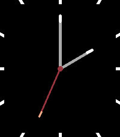
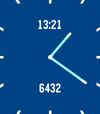
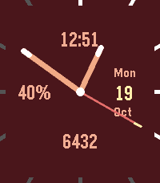

# Thin+

Thin, plus: a clean analog Pebble watchface with splashes of color and the
information you choose.

## Features

- Smooth, anti-aliased hands, precisely aligned tips, and optional thicker
  hour and minute hands.
- A battery-friendly second hand, shown for 15 seconds after launch or a
  wrist flick. Otherwise, the face updates once a minute.
- Three complication slots (top, left and bottom): steps, heart rate,
  battery percentage, digital time or none. Numbers only, without labels.
- Classic, Neon, Ocean, Sunset, Lime, Mono and Paper themes, plus Custom.
- Individual colors for the background, hands, tips, center dot, hour
  markers, empty battery markers and date.
- Hour markers that show battery level, optional date and disconnected
  indicator.

Keep it minimal: hide the date and leave any or all complication slots empty.

Settings are provided by [Clay](https://github.com/pebble/clay).
Colors and health readings depend on the watch's capabilities.

## Platforms

Targets aplite, basalt, chalk, diorite, emery, flint and gabbro. The release
preparation includes an install, default rendering and crash-log smoke test
for each platform; this does not verify the phone settings page on every watch.

## Build

With the Pebble SDK installed, run `pebble build`. The bundle is
`build/thin-plus.pbw`. Run `pebble clean` before rebuilding after changing
the message keys in `package.json`.

## Release preparation

[Thin+ 1.1.0 is available on the Pebble App Store](https://apps.repebble.com/b0a4b28dbe9440c3b19f68e3).
The release is published and publicly listed. Version 1.1.0 passed builds and
emulator checks on all seven platforms. Its physical PT2 store-install and
settings check is pending; the owner previously confirmed that flow for 1.0.0.
See [listing draft](store/listing.md) and [release manifest](store/manifest.md)
for assets, validation evidence and approval status.

Version 1.1.0 adds an option to show selected battery complications only below
20%. It defaults to off and is independent of the hour-marker battery display.
See [behavior and test notes](docs/LOW-BATTERY-COMPLICATION.md).

## Credit

Based on [Thin by Chris Lewis](https://apps.repebble.com/thin_550ccb556caaed4e0100006d).
Thin+ is maintained by Edward Wijaya.

## Release 1.2.0

Thin+ 1.2.0 is published on the Pebble App Store. This source snapshot is
reconstructed from the saved release patch and verified against every original
binary-input hash. See [release details](store/release-1.2.0.md) and
[source inventory](docs/RELEASE-SOURCE-1.2.0.json).
